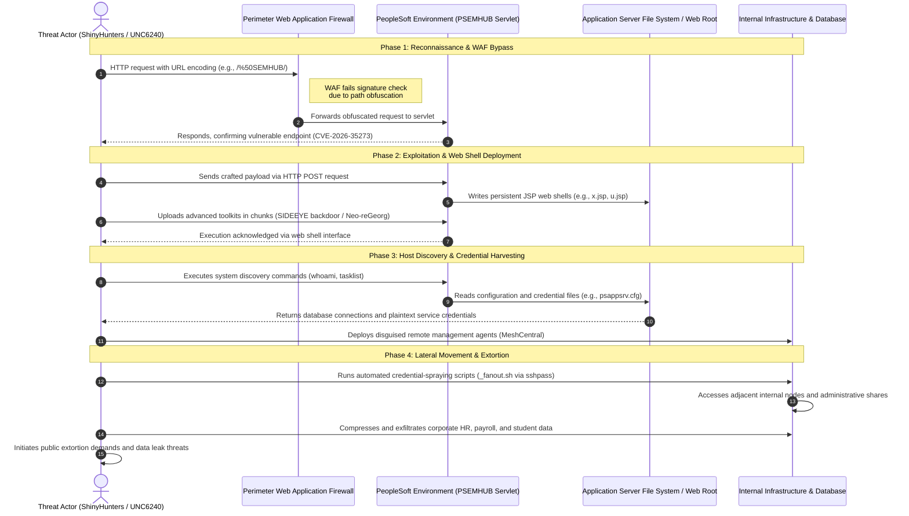

Group members:
1.Ofek Drori
2.David Voloshin

CTI report link:
https://cloud.google.com/blog/topics/threat-intelligence/shinyhunters-renewed-mass-exploitation-campaign-targeting-oracle-peoplesoft

The summary:
The threat actor group ShinyHunters (UNC6240) launched a renewed, mass-exploitation campaign targeting organizations running Oracle PeopleSoft software.
 The attacks leverage a modified exploit for CVE-2026-35273—a critical remote code execution vulnerability in the Environment Management Hub (PSEMHUB) servlet.
 Specifically, the hackers bypassed traditional string-based Web Application Firewall (WAF) rules by using simple URL encoding (such as request paths like /%50SEMHUB/) to trick security filters.
 Once inside unpatched environments, the actors deploy persistent JSP web shells and advanced toolkits like the SIDEEYE backdoor to harvest credentials and establish command-and-control access.
 This campaign specifically targets enterprises that relied solely on perimeter WAF rules rather than applying official software patches.
 The ultimate objective of the campaign is extensive data theft, followed by extortion and threats to leak stolen corporate data.
 
 ## ShinyHunters Oracle PeopleSoft Attack Lifecycle

### MITRE ATT&CK Mapping

| Tactic | Description | Technique |
| :--- | :--- | :--- |
| Reconnaissance | איסוף המידע הראשוני על היעד ותשתיותיו לצורך תכנון התקפה | T1596.003 Search Open Technical Databases: Digital Certificates |
| Reconnaissance | איסוף המידע הראשוני על היעד ותשתיותיו לצורך תכנון התקפה | T1596.005 Search Open Technical Databases: Scan Databases |
| Reconnaissance | איסוף המידע הראשוני על היעד ותשתיותיו לצורך תכנון התקפה | T1595.002 Active Scanning: Vulnerability Scanning |
| Initial Access | החדירה וההשגה של דריסת הרגל הראשונית ברשת היעד | T1190 Exploit Public-Facing Application |
| Defense Evasion | טשטוש עקבות והסוואת הפעילות כדי לחמוק ממנגנוני אבטחה | T1027 Obfuscated Files or Information |
| Execution | הרצת קוד זדוני או פקודות בתוך המערכת | T1059.003 Command and Scripting Interpreter: Windows Command Shell |
| Execution | הרצת קוד זדוני או פקודות בתוך המערכת | T1059.004 Command and Scripting Interpreter: Unix Shell |
| Persistence | שמירה על אחיזה ויכולת גישה רציפה למערכת גם לאחר אתחול | T1505.003 Server Software Component: Web Shell |
| Discovery | סריקה ולמידת סביבת השרת, הקבצים וההרשאות הפנימיות | T1082 System Information Discovery |
| Discovery | סריקה ולמידת סביבת השרת, הקבצים וההרשאות הפנימיות | T1016 System Network Configuration Discovery |
| Credential Access | גניבת סיסמאות ומפתחות גישה לטובת הרחבת השליטה במערכות | T1552.001 Unsecured Credentials: Credentials In Files |
| Command and Control | תקשורת ושליטה מרחוק ברכיבים הנגועים דרך שרתי התקף | T1090 Proxy |
| Command and Control | תקשורת ושליטה מרחוק ברכיבים הנגועים דרך שרתי התקף | T1219 Remote Access Software |
| Exfiltration | הוצאה והברחה של מידע רגיש מתוך המערכת לשרת חיצוני | T1048 Exfiltration Over Alternative Protocol |
