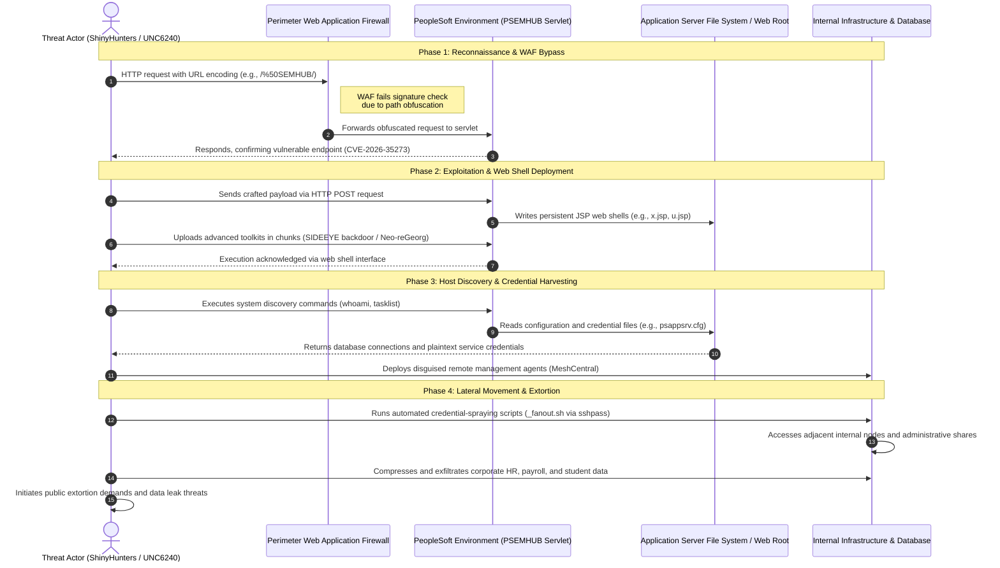

Group members:
1.Ofek Drori
2.David Voloshin

CTI report link:
https://cloud.google.com/blog/topics/threat-intelligence/shinyhunters-renewed-mass-exploitation-campaign-targeting-oracle-peoplesoft

The summary:
The threat actor group ShinyHunters (UNC6240) launched a renewed, mass-exploitation campaign targeting organizations running Oracle PeopleSoft software.
 The attacks leverage a modified exploit for CVE-2026-35273—a critical remote code execution vulnerability in the Environment Management Hub (PSEMHUB) servlet.
 Specifically, the hackers bypassed traditional string-based Web Application Firewall (WAF) rules by using simple URL encoding (such as request paths like /%50SEMHUB/) to trick security filters.
 Once inside unpatched environments, the actors deploy persistent JSP web shells and advanced toolkits like the SIDEEYE backdoor to harvest credentials and establish command-and-control access.
 This campaign specifically targets enterprises that relied solely on perimeter WAF rules rather than applying official software patches.
 The ultimate objective of the campaign is extensive data theft, followed by extortion and threats to leak stolen corporate data.
 
 ## ShinyHunters Oracle PeopleSoft Attack Lifecycle

### MITRE ATT&CK Mapping

| Tactic | Description | Technique |
| :--- | :--- | :--- |
| Reconnaissance | Gathering preliminary information about the target and its infrastructure to plan the attack | T1596.003 Search Open Technical Databases: Digital Certificates |
| Reconnaissance | Gathering preliminary information about the target and its infrastructure to plan the attack | T1596.005 Search Open Technical Databases: Scan Databases |
| Reconnaissance | Gathering preliminary information about the target and its infrastructure to plan the attack | T1595.002 Active Scanning: Vulnerability Scanning |
| Initial Access | Gaining an initial foothold within the target network | T1190 Exploit Public-Facing Application |
| Defense Evasion | Hiding or disguising malicious activity to bypass security controls | T1027 Obfuscated Files or Information |
| Execution | Running malicious code or commands on the targeted system | T1059.003 Command and Scripting Interpreter: Windows Command Shell |
| Execution | Running malicious code or commands on the targeted system | T1059.004 Command and Scripting Interpreter: Unix Shell |
| Persistence | Maintaining long-term access to the system across restarts | T1505.003 Server Software Component: Web Shell |
| Discovery | Exploring and mapping the internal server environment, files, and configurations | T1082 System Information Discovery |
| Discovery | Exploring and mapping the internal server environment, files, and configurations | T1016 System Network Configuration Discovery |
| Credential Access | Stealing passwords and access tokens to expand control across systems | T1552.001 Unsecured Credentials: Credentials In Files |
| Command and Control | Communicating with and managing compromised systems via attacker servers | T1090 Proxy |
| Command and Control | Communicating with and managing compromised systems via attacker servers | T1219 Remote Access Software |
| Exfiltration | Stealing and transferring sensitive data out of the target network | T1048 Exfiltration Over Alternative Protocol |

